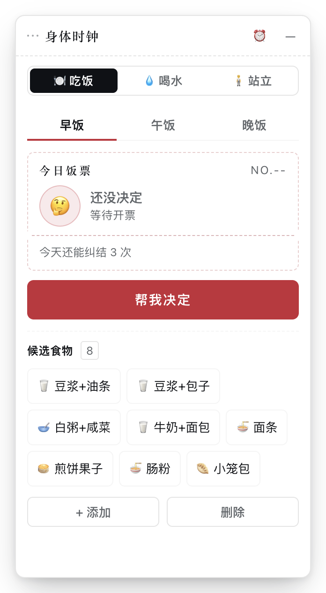
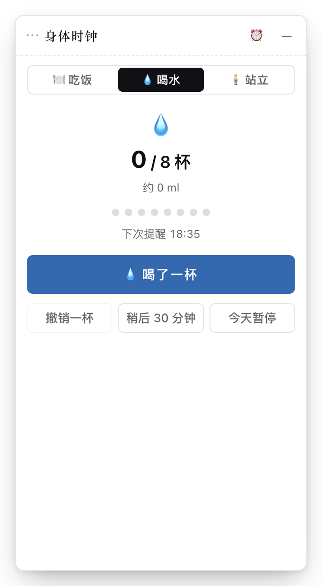
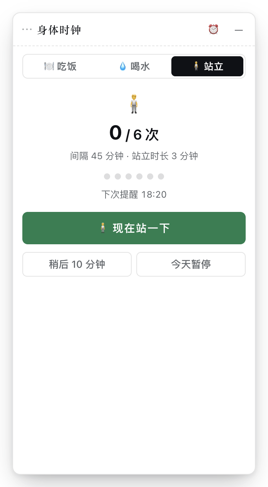
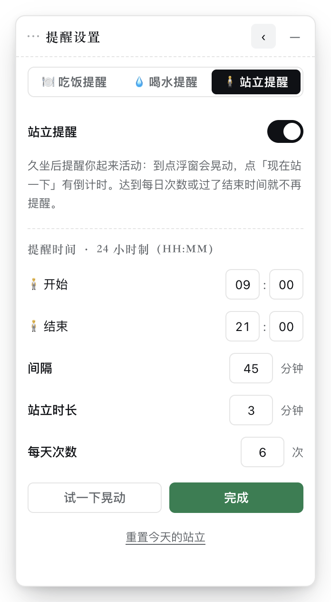
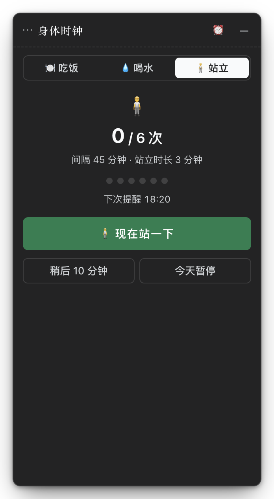

# 身体时钟 · 桌面版

把 DSH 插件 `dsh-body-clock` 的悬浮窗搬成**独立桌面应用**：不用打开 DSH，
双击图标就有一个常驻的小浮窗，帮你决定今天吃什么、提醒喝水、提醒站起来。

界面、逻辑、音效和 DSH 插件版的 `client.js` 是**同一份源码**，两边永远同步。

---

## 装哪个包

| 系统 | 文件 | 说明 |
| --- | --- | --- |
| macOS（Apple 芯片） | `BodyClock-<版本>-arm64.dmg` | M1 / M2 / M3 / M4 |
| macOS（Intel） | `BodyClock-<版本>-x64.dmg` | |
| Windows（安装版） | `BodyClock-Setup-<版本>.exe` | 会装到开始菜单，可开机自启 |
| Windows（免安装） | `BodyClock-<版本>-.exe`（portable） | 双击即用，不写注册表 |

产物在 GitHub Actions 的 Artifacts 里，或者本地 `npm run dist:mac` / `dist:win` 得到。

## 第一次打开

**macOS**：这个版本没有做代码签名（本地自用），系统会拦一下。
在应用上**右键 →「打开」**，或在「系统设置 → 隐私与安全性」里点「仍要打开」。
之后就不会再问了。

**Windows**：SmartScreen 提示时点「更多信息 → 仍要运行」。

## 怎么用

- 启动后是一个 **32px 的悬浮球**，点一下展开成完整窗口，右上角 `—` 收回去。
- 按住**标题栏**拖动窗口；收起状态下拖那颗球。
- **托盘/菜单栏图标**：显示或隐藏窗口、切换始终置顶、开机自动启动、回到初始位置、退出。
- 关窗口是**收进托盘**，不是退出——提醒还会继续响。要彻底退出请用托盘菜单。
- 三套提醒、饭票动画、候选食物、喝水计数、站立倒计时，全部和插件版一致。
- 深浅色跟随系统，不需要手动切。

## 界面

| 吃饭 | 喝水 |
| :---: | :---: |
|  |  |

| 站立 | 提醒设置 |
| :---: | :---: |
|  |  |

深色模式（跟随系统，图中为站立页）：



## 和 DSH 插件版的区别

| | 插件版 | 桌面版 |
| --- | --- | --- |
| 运行位置 | DSH 窗口内的浮层 | 独立的系统窗口 |
| 数据存放 | DSH 的 localStorage | 应用自己的 localStorage |
| 是否互相影响 | 互不影响，各存各的 | 互不影响，各存各的 |
| 界面代码 | `../client.js` | 同一份 `../client.js` |

也就是说：**两边的「今天吃了什么」不会同步**。插件版继续在 DSH 里用，桌面版独立跑。

## 开发

```bash
cd desktop
npm install

npm run build:renderer   # 把 ../client.js + 垫片 + React 打成一个 bundle
npm start                # 构建后启动（等于 build:renderer + electron .）
npm run dev              # 只启动，不重新构建
npm run icons            # 重新生成 build/icon.png 与托盘图标（需要 macOS）
npm run dist:mac         # 出 .dmg / .zip
npm run dist:win         # 出 .exe（在 Windows 上跑，或交给 CI）
```

> ⚠️ 如果你在 DeepSeek Harness 的集成终端里启动，注意 DSH 会给子进程设
> `ELECTRON_RUN_AS_NODE=1`。带着它启动会让 Electron 退化成普通 Node——不建窗口、
> 不加载 `main.js`，而且**不报错**。`scripts/electron-run.mjs` 已经处理了这件事，
> 所以请用 `npm start` 而不是直接 `electron .`。

### 目录

```
desktop/
  src/
    main.js        主进程：开窗、托盘、IPC、开机自启
    preload.js     唯一的安全桥（env / setFrame / onPing / onThemeChange）
    boot.js        垫片：补出 DSH 的 __ModuleLoader__ / ctx.locale / ctx.slots，然后渲染
    theme.css      把 DSH 的 --dsw-alias-* 主题变量在独立窗口里补回来
    index.html
  scripts/
    build-renderer.mjs  esbuild 打包
    electron-run.mjs    启动器（清掉 ELECTRON_RUN_AS_NODE）
    icons.js            从 SVG 栅格化图标（借 Electron 渲染）
  assets/          托盘图标（template image）
  build/           应用图标源图（1024×1024）
  electron-builder.yml
```

### 它是怎么做到「一份源码」的

`client.js` 不是 ES 模块，而是「向 DSH 加载器注册一个工厂」的脚本：

```js
window.__ModuleLoader__.load({ id, factory(require) { ... } })
```

桌面版的做法：

1. esbuild 的 `banner` 在整个 bundle 最前面补出 `window.__ModuleLoader__`；
2. `boot.js` 直接 `import '../../client.js'`，它照着插件协议注册工厂；
3. `boot.js` 再造一个假的 `ctx`（`locale` / `slots` / `effect`），让工厂里的
   `apply(ctx)` 正常跑完，`slots.register` 拿到的渲染函数直接喂给 `ReactDOM.createRoot`。

所以 `client.js` **一行都不用改**。改插件时桌面版只需重新 `npm run build:renderer`。

### 浮层怎么变成窗口

`client.js` 自己管拖拽：它把位置记在 state 里，渲染成根节点的 inline `left/top`，
并用 `window.innerWidth/innerHeight` 算边界。桌面版做了三件事对齐它：

1. `boot.js` 覆盖 `innerWidth/innerHeight` 为**屏幕工作区尺寸**，否则窗口只有 316px 宽，
   一拖就被 clamp 卡死；
2. `theme.css` 用 `!important` 把根节点钉在窗口内的 16px 边距上（inline 的 `left/top`
   仍然留在 DOM 上，只是不再影响布局）；
3. `boot.js` 每帧读那对 inline 坐标，通过 IPC 让主进程移动窗口。

于是「拖元素」在视觉上就是「拖窗口」，而 `client.js` 里的拖拽、点击判定、
边界 clamp 逻辑全都原样保留。

## 已知限制

- **没有代码签名 / 公证**：首次打开需要右键「打开」。要分发请自行配置证书。
- **没有自动更新**：换版本需要重新下载安装。
- **透明边距会挡鼠标**：窗口为投影预留了四边各 16px 的透明区域，这块区域会吃掉
  鼠标点击（不穿透）。这是为了让浮窗有正常阴影做的取舍。
- **提醒只有窗口内反馈**：不弹系统通知，声音与晃动和插件版一致。
